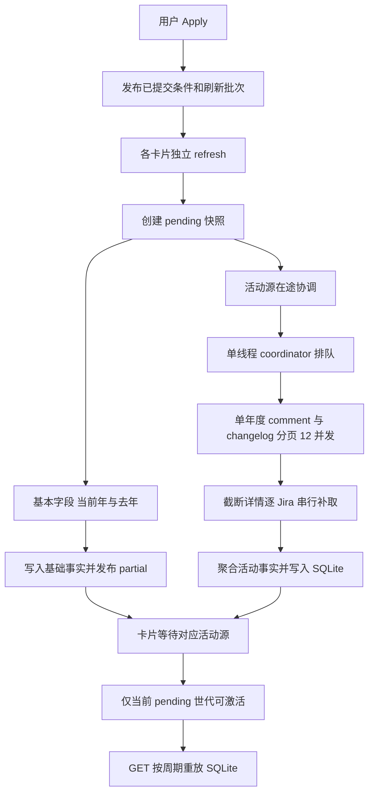

# Jira 页面卡片业务开发基线与优化规划

> 状态：Coco 已确认基线并授权交付；专项优化尚未开始。日期：2026-10-14。需求与验收负责人：Atlas；唯一开发助手：Mason。
> 本文记录已确认需求、当前工作区实现及后续执行清单。本文获确认后，先随当前工作区完成审查、提交、合入主分支及推送；工作区干净后再开展专项优化。本文不代表性能问题已经解决，也不授权现在修改业务实现。

## 1. 目的、范围与阅读约定

目标是在不改变统计口径、授权边界和快照机制的前提下，建立可维护、可测量的 Jira 卡片体系，定位并优化活动数据获取中的 502、跨卡排队和长时间 loading。

- **业务范围**：导航栏 Jira 页面中的 Self-Test、Task、Customer Feedback 卡片及其筛选、统计、异步获取和 SQLite 快照。
- **范围外**：Dashboard 等其他页面、日报、周报、审查、背景动画及其他工作区改动。共享 Core 能力的修改必须评估这些消费者，不能顺带改变其行为。
- **保留原则**：基本字段链路已有验证，尽量保持原行为；不擅自新增业务条件、QA creator/owner 限制、兜底、重试或第二套缓存。
- **事实基线**：本文描述的是当前未提交工作区，不是某个已发布版本。历史设计与本文有差异时，先对照 Coco 最新需求和实际代码，不能以旧文档恢复已删除机制。
- **标记约定**：“已确认需求”为 Coco 的业务要求；“当前实现”为代码事实；“待确认/待验证”为不能直接实施或宣称通过的事项。

本文与执行清单保持在同一文件，不另建实施计划。根目录 `AGENTS.md` 的交付、安全及 ownership 边界仍然适用。

## 2. Coco 已确认的需求

| 编号 | 需求与不可改变的口径 |
| --- | --- |
| R1 | 各卡片有独立业务范围，不先获取公共大集合再由卡片过滤。共享筛选器只发布用户已提交条件。 |
| R2 | 活动查询范围为：年度 created 条件 AND 用户已提交 JQL AND 卡片业务条件。不得加 QA creator/owner 限制；非 QA 创建的 Jira 也可能被 QA 评论或 Verify。 |
| R3 | Self-Test 为 Bug＋Self-Test；Task 为 Task；Customer Feedback 保留既有客户反馈业务条件，不自行简化或扩大范围。 |
| R4 | Comment 按 QA 评论作者计数；Verify 对每个 Jira 取最后一次 Resolved → Verified 的操作者，仅该操作者为 QA 时计数。 |
| R5 | 活动统计的 QA 名单和产品线来自 `core/config/personnel.json`，按人员归属分类，不按 Jira 项目分类。基本字段链路暂保留，来源差异见第 9 节。 |
| R6 | 今年、去年分别获取；展示周期按 Jira 创建时间拆分，不能误写成按评论或 Verify 的发生时间统计。 |
| R7 | 显式 Apply 必须刷新远端。GET 卡片统计和周期切换只读取 SQLite，不启动远端活动查询。 |
| R8 | SQLite 是事实及查询快照唯一持久 owner；进程内只放任务、进度、取消和在途协调；前端展示缓存不能成为业务范围来源。 |
| R9 | Jira 页面业务 JQL 集中到 `core/jira/jql.py`，条件语法组合继续复用 `compose_jql`。 |
| R10 | 两类取数能力分别为基本字段与 comment＋changelog。当前 4/12 并发参数不等于已经实现全卡共享两个并发池；共享调度设计需明确后再实现。 |
| R11 | 先确认本文并完成工作区交付，干净后再重点优化。Web 服务由 Coco 启动，未经指示不得停止或重启。 |

## 3. 卡片机制与指标

### 3.1 卡片结构

三个卡片共享统计组件、筛选发布机制、任务管理和快照 repository，但分别构建 JQL、执行查询、记录状态与展示结果。当前/上一周期分别有可用性，不能因为基础字段已完成就把 Comment 或 Verify 显示为已完成的零值。

基础层提供创建数量、Invalid、components 等统计；活动层提供 Comment 与 Verify。Customer Feedback 首指标展示 components；Invalid 展示 Total、Invalid 及比例；人员指标由 ranking-card 展示。具体字段及布局沿用当前组件，不在性能优化中重新定义。

### 3.2 基础层：当前实现，暂保留

- `load_fae_qa_roster` 从 Jira 用户组读取 QA：`fae-wifi-qa`、`fae-SH-qa`、`fae-stb-qa`、`fae-tv-qa`、`fae-iptv-qa`。
- 基础查询包含 QA creator 组条件；基础数量按 creator 计数，非 QA creator 不计入基础总量。
- 产品线归属优先采用无线 QA 归属，否则按 Jira project 映射。
- Invalid 当前判断为 `resolution.name == "Invalid"`；不能与客户反馈无线分支的 resolution 排除条件混为一谈。
- components 对单个 Jira 的不同名称去重计数。

上述是基础链路现状，不是将活动查询限制到 QA 创建范围的理由。

### 3.3 活动层：Comment 与 Verify

`load_activity_qa_roster` 读取 `core/config/personnel.json` 中 `FAE-QA.employees`；活动贡献按人员归属产品线统计。

| 指标 | 统计规则 | 必须避免的误解 |
| --- | --- | --- |
| Comment | 遍历查询范围内 Jira 的评论，按 QA 评论作者累计贡献 | 不是按 Jira creator、assignee 或项目归属计数 |
| Verify | 每个 Jira 先找最后一次 Resolved → Verified，再判断操作者是否为 QA；每个 Jira 至多一次贡献 | 不能累计所有历史 Verify，也不能跳过最后一次非 QA 操作后回找更早 QA |
| 周期归属 | 使用 Jira 的 `createdAt` | 不是 comment.created 或状态转换时间 |

当前人员配置中多产品线归属会分别贡献，无归属有 unassigned 计数；此处如实记录，不新增去重、推断产品线或静默丢弃规则。Verify 当前状态匹配与严格口径的差异见第 9 节。

## 4. JQL 的所有权、组合与边界

### 4.1 唯一职责

- `core/jira/jql.py::CARD_BUSINESS_JQL`：卡片业务谓词。
- `core/jira/services/filter_service.py::compose_jql`：交集组合、括号及 ORDER BY 处理，其他层不再拼一套语法。
- `effective_card_jql_pair`：基本字段今年/去年条件组合。
- `activity_card_jql_pair`：活动字段今年/去年条件组合。
- `jira_api.py`：解析认证账号、卡片定义和用户请求，交给已有 owner；不另建隐藏卡片约束。

逻辑表达如下，实际字符串必须由已有组合函数生成：

```text
基本字段有效 JQL = 用户已提交条件 AND 卡片业务条件 AND QA creator 组条件 AND 年度 created 范围
活动字段有效 JQL = 用户已提交条件 AND 卡片业务条件 AND 年度 created 范围
```

用户草稿与 effective JQL 分开保存。校验、远端执行、SQLite 记录要能追溯到同一有效查询，不能查询结束后悄悄加条件或扩大范围。

### 4.2 卡片业务谓词

| 卡片 key | 当前固定业务条件 |
| --- | --- |
| `self-test` | `issuetype = Bug AND "Channel of Reporter" = "Self-Test"` |
| `task` | `issuetype = Task` |
| `customer-feedback` | `issuetype = Bug AND "Channel of Reporter" = "Customer-Feedback" AND (无线分支 OR 标准分支)` |

Customer Feedback 的现有分支必须完整保留：

- 无线标签集合：`Customer_W1`、`Customer_W1U`、`Customer_W2L`、`customer_w2`、`Customer_w1u`、`customer-w2`、`customer-w2L`、`customer_w1d`。
- 无线分支：命中上述 labels；resolution 为空或不在 `Invalid Case`、`Cannot Reproduce`、`HW Fix`、`Won't Fix`、`Won't Do` 中；project 不在 `RD SW Platform`、`Wireless Project` 中。
- 标准分支：project 属于 `core.product_lines.PRODUCT_LINE_BY_JIRA_PROJECT` 的键；labels 为空或不属于上述无线标签。

这些条件由业务 owner 定义，文档不充当另一份运行时配置。条件变更必须同步代码、回归和本文，不能因性能问题删掉筛选限制。

### 4.3 年度获取与展示周期

Web 分别拉取今年、去年的年度数据。周期切换复用年度事实，不按每次周/月选择重新请求 Jira。

`JIRA_PERIODS` 支持 `week/month/quarter/year`，当前默认 month。`jira_period_ranges` 以本周周一、本月 1 日、本季度首日、本年 1 月 1 日作为本周期起点，到 now 为止；上一周期为上一完整周期，右边界不包含本周期起点。年度远端 JQL 和本地周期边界必须复用现有时间函数，不能在前端新增另一套计算。

需要覆盖跨年上一周期、日期边界和本地事实可用范围；不能以单一“今年”查询代替今年与去年两份来源。

## 5. 页面交互与接口

### 5.1 用户操作流程

| 操作 | 当前流程及契约 |
| --- | --- |
| 进入 Jira 页面 | 可丢弃的账号展示缓存用于首帧，随后 GET 用 SQLite 原位校准；不因重进页面发起活动取数 |
| 修改 Basic/Advanced 或 saved filter | 修改草稿、获取候选或校验；未 Apply 不改变已应用结果范围 |
| 点击 Apply | 验证并发布用户条件/刷新批次，各卡片独立发 refresh；显式刷新不得直接命中旧完成结果冒充远端刷新 |
| 切换周期 | 保存周期偏好，以 reuse 读取 SQLite 年度事实重新聚合，不请求远端活动数据 |
| 任务运行 | 轮询状态、展示进度和 partial；按年度与数据层 availability 控制指标可用性 |
| 成功 | 当前有效 pending 快照激活，呈现结果；成功零条是 ready 空结果，不是失败 |
| 失败/取消 | 明确显示失败或取消并停止轮询；符合条件的旧有效结果可以保留，不将未知数写成零 |
| 离开页面 | 停止组件轮询；旧异步响应通过 generation 隔离，不能覆盖新一轮页面状态 |
| 筛选器 Reset | **当前只清空控件草稿**，不会自动发布条件或重建快照；与仓库 Reset 契约的差异单列处理 |

前端默认轮询间隔为 800ms。loading 时提供 partial，failed/cancelled 在无新数据时不主动清空已有图；`no_snapshot` 会明确清空。旧 active 结果是否能重放取决于条件、年度 JQL、名单指纹等匹配，不能承诺任意失败都展示任意旧范围的结果。

### 5.2 接口职责

| 接口 | 职责 |
| --- | --- |
| GET `/api/jira/analytics/state` | 恢复已应用共享条件 |
| GET `/api/jira/analytics/fields`、`suggestions` | 字段及输入候选，不是卡片全量查询入口 |
| GET `/api/jira/analytics/saved-filters`、`saved-filters/{filter_id}` | 保存筛选器列表及内容 |
| POST `/api/jira/analytics/validate` | 校验用户条件 |
| POST `/api/jira/analytics/search` | 验证并发布共享条件，不先查公共 Jira 大集合 |
| POST `/api/jira/cards/{card_key}/query` | `intent=refresh` 启动该卡查询；`intent=reuse` 本地重放，可保存 period |
| GET `/api/jira/cards/{card_key}/statistics` | SQLite 统计、partial 和状态；不启动远端查询 |
| GET `/api/jira/cards/{card_key}/tasks/{task_id}` | 当前真实会话有权读取的卡片任务状态 |
| DELETE `/api/jira/cards/{card_key}/tasks/{task_id}` | 当前真实会话有权取消的卡片任务 |

“GET 只读 SQLite”的核心约束针对卡片统计与结果恢复，不能误写成字段候选/保存筛选器等全部 Jira API 都禁止访问远端元数据。

## 6. 异步链路：当前实现



### 6.1 并发不是全卡共享 4＋12

| 能力 | 当前参数与调度 | 影响 |
| --- | --- | --- |
| 基本字段分页 | Web 每页 100；每个 gateway 自有 4 worker | 多卡 gateway 同时运行可能叠加，不是全局 4 路 |
| 活动分页 | `fields=[comment,created]`，`expand=[changelog]`，每页 1000；单查询新建 12 worker | 12 指单个活动查询内部并发 |
| 活动源协调 | `submit_coordinator()` 的线程池为 1 worker | 不同卡片、年度源按队列执行，后续卡片可能长时间未开始请求 |
| 年度依赖 | 当前年、去年按依赖顺序执行 | 当前年失败可使去年直接依赖失败，不能将其误报为去年也发生远端 502 |
| 截断详情补取 | 分页返回后逐 Jira 补取 | 不属于前面的 12 路分页池，可能增加长尾耗时 |

gateway 先读取首页确定总量，再调度后续分页；最终去重汇集。基础任务和活动源任务可以并行推进，因此基础指标较早可用不意味着活动源已经开始。

### 6.2 完整性、失败与取消

- comment 内嵌结果被截断时，继续通过评论分页接口补齐。
- changelog 不完整时，通过单 Jira 的 `get_issue(..., expand="changelog")` 补取；仍不完整时明确失败，不以不完整历史计算 Verify。
- HTTP 502 原策略为最多 4 次尝试，间隔 0.25/0.5/1 秒；此次规划不把增加重试作为解决方案。
- 已增加分页失败后取消尚未启动 Future 的修复；在途请求仍需结束，因此首个分页失败和整个活动任务终态之间可能仍有延迟。
- pending 失去运行任务时按 interrupted 失败收敛；取消/失败应是终态，不可一直显示 loading。
- comment 与 changelog 共用活动请求，changelog 失败会影响 Comment 和 Verify 两者可用性；是否隔离是待确认设计，不是现有能力。

### 6.3 复用边界

活动源的范围包含有效查询及人员名单指纹；在相同账号、范围、刷新 revision 下可以复用在途任务或对应 SQLite source。不同卡片业务范围通常不同，不能仅因年度相同就共用结果。

新的显式 Apply 必须产生/使用正确刷新批次，不能复用旧完成批次跳过远端刷新。进程内在途索引只协调运行，不保存长期结果；任务结束后清理在途条目。

## 7. SQLite、状态与隔离

| 持久对象 | 用途与 owner |
| --- | --- |
| `jira_analytics_queries` | 已发布条件，active/pending/last 指针，任务 ID 及真实任务会话 |
| `jira_analytics_snapshots` | 有效 JQL、用户条件、卡片、名单指纹、状态与统计 metadata |
| `jira_analytics_snapshot_issues` | 快照与 Jira 成员关系、顺序、current/previous |
| `jira_analytics_facts` | 按快照与 Jira 保存年度统计事实 JSON |
| `jira_issues` 及关联基础事实表 | 由 `JiraIssueRepository` 管理基础 Jira 事实 |

schema 位于 `web/backend/smarttest_web/jira/schema.py`；查询快照生命周期由 `JiraAnalyticsRepository` 管理。活动统计存储的是统计贡献事实，不应将通用 `jira_issue_comments` 表描述为本链路完整原始评论的持久路径，也不能将沙盒响应落盘等同生产入库。

`local_statistics` 只读 SQLite，合并相同 revision 活动源后按 `createdAt` 聚合。`activate` 只允许当前 pending 生效，旧任务不能覆盖新 Apply；失败保留有效 active，展示时仍要检查范围匹配。

当前卡片结果/条件按账号 scope 恢复；任务读取及取消按真实会话＋卡片隔离。跨账号不得复用快照；同账号另一会话能够恢复允许的结果不等于能控制原会话任务。账号退出、撤销及其他页面既有快照策略不能在本轮性能优化中被统一改写。

前端缓存仅用于首帧展示，在账号切换/注销时清理，并由 SQLite 响应校准；不能从中读取审查、导出或批量动作的权威资源 ID。

## 8. 封装能力与维护入口

路径均相对仓库根目录。扩展时先复用对应 owner，不能为了某张卡片再建一套状态、传输或统计流程。

| 文件/能力 | 负责什么 | 不负责什么 |
| --- | --- | --- |
| `core/jira/jql.py` | Jira 页面卡片固定业务谓词 | HTTP、任务、前端状态 |
| `core/jira/services/filter_service.py` | Basic 条件、compose_jql、周期函数与筛选能力 | 第二套卡片业务约束 |
| `core/jira/services/jql_statistics_cards.py` | 卡片定义、年度 JQL pair、名单、年度事实与周期聚合 | Web 任务生命周期、SQLite schema |
| `core/jira/mapper.py` | Jira payload 映射、最后一次 verification 识别 | 卡片请求排队、页面交互 |
| `core/jira/gateway.py` | 复用 Atlassian SDK 请求、字段投影、分页、完整性补取与错误归一 | 卡片页面状态或业务结果缓存 |
| `web/backend/smarttest_web/jira_api.py` | 认证、卡片路由、请求适配、重放与响应 | 重写 Core JQL/计数规则 |
| `web/backend/smarttest_web/jira/analytics_service.py` | 校验、pending、基础/活动源串接、阶段进度、提交结果 | 自建日志、数据库 owner |
| `web/backend/smarttest_web/jira/analytics_tasks.py` | 会话卡片任务索引、活动源在途复用、状态与取消 | 永久事实缓存 |
| `core/async_tasks.py` 与 Web `task_manager.py` | 通用运行任务、worker/coordinator、进度和取消 | Jira 业务谓词；不能随意为卡片改变全部消费者 |
| `web/backend/smarttest_web/jira/analytics_repository.py` | 快照状态、年度事实、本地重放和激活隔离 | 请求远端补数据 |
| `web/backend/smarttest_web/jira/issue_repository.py`、`schema.py` | 基础事实及 schema | 前端展示缓存 |
| `web/frontend/src/jira-filter-builder.js` | 筛选草稿、校验、Apply 发布与控件交互 | 权威查询集合 |
| `web/frontend/src/jira-main.js` | 将已发布条件分发给各卡片 | 公共全量查询 |
| `web/frontend/src/widgets/jira-statistics-card.js` | 缓存首帧、GET 校准、周期、轮询、可用性和终态 | 自行统计或隐式启动远端查询 |
| `core.logging` | 统一日志协议、文件及输出 | 另一套私有 logger 或临时 print |

## 9. 已知差异与待确认项

| 项目 | 当前事实 | 后续处理边界 |
| --- | --- | --- |
| 共享并发 | 基础每 gateway 4；活动串行协调＋单查询 12 | 全卡共享 4/12 是待设计方向，不写成已实现或立即把 coordinator 调大 |
| QA 名单及产品线 | 基础远端组/项目映射；活动 personnel/人员归属 | 基础已验证应先保留；若要统一全部指标来源，必须明确口径和影响后再改 |
| Verify 状态 | `last_verification` 对 casefold 后状态名做子串匹配 | 与严格 Resolved → Verified 可能不同；列为需确认的规则差异，不趁性能优化静默调整 |
| 筛选器 Reset | `jira-filter-builder.js` 只清未提交草稿 | 与 AGENTS 中清除已应用条件并重建快照的契约有差异；仅指此控件，单独确认修复范围 |
| 失败耦合 | comment/changelog 共用请求且年度有依赖 | 是否隔离指标或年度失败，需要确认结果完整性与请求量权衡 |
| 统计性能 | 已有基本字段及小样本验证 | 不等于全量 changelog、补取、生产入库、轮询展示均已验证 |

这些条目不是本轮新增实现清单，不得因本文被提交就自动改变业务行为。具体优化采用第 11 节的证据与决策门槛。

## 10. 性能证据与诊断口径

### 10.1 沙盒基线：必须保留参数差异

固定实验 JQL：

```jql
created >= "2026-01-01" AND created < "2026-10-14" ORDER BY key
```

| 取数字段与参数 | 已报告实验结果 |
| --- | --- |
| CORE_FIELDS＋comment，100 条/页、4 并发 | 约 149,131 唯一 Jira，524 秒 |
| CORE_FIELDS＋comment，100 条/页、12 并发 | 149,693 Jira，394 秒；4 次 502 重试恢复 |
| 仅 comment，1000 条/页、12 并发 | 149,693 Jira，151.5 秒；无失败；响应解码后约 2.04GB |
| comment＋created＋changelog | 只预检今年/去年各 100 条，约 1.03/1.46 秒；没有全量验证 |

151.5 秒包括约 150.93 秒获取及 JSON 解析、0.57 秒作者计数。0.57 秒不代表处理全部原始响应的总成本。上述实验未包含生产 SQLite 入库和 Web 展示，数据条数差异也不能未经核对就视为同一不可变数据集。

证据位置：`build/jira_comment_sandbox/concurrency_experiment.py`、`four_directions.py`、`concurrency_20261014/`、`four_directions_20261014/`、`activity_precheck_20261014.json`。这些是本地实验资料，交付时核对是否被忽略及可复现性，不将本地文件存在当作已纳入版本控制。

### 10.2 已分析的生产运行窗口

2026-10-14 16:27:45 Apply，截至 16:39:42 的历史采样（不是持续更新的当前状态）：

- Self-Test 基础当前/去年分别 5896/6877 条，基础处理完成。
- Self-Test 活动先排队约 172 秒，远端阶段约 311 秒后失败；7 个分页各 4 次尝试仍为 HTTP 502，每页累计约 242 秒，不少单请求约 60 秒后失败。
- Self-Test 去年活动因依赖失败未发起远端查询，不得算作另一组远端失败。
- Customer Feedback 活动排队约 482 秒后启动；采样时已有 51 页成功、51,000 条原始记录，仍有请求在途。这不是完整总数，也不是唯一 Jira 总数。
- 两卡观测到 12 个并行请求峰值。活动尚未入库就失败；本轮没有 SQLite 失败证据，本地读取与聚合在毫秒级。

HTTP 502 与约 60 秒特征不能直接归因到 Jira、代理或网关哪一层。SQLite 保存 `jira_search_failed` 只说明记录了远端任务失败，不说明数据库写入失败。并发请求耗时之和不是墙钟耗时。

### 10.3 日志与后续测量

正式 JSONL：`C:\Users\SH171300-1522\AppData\Local\Amlogic\SmartTest\logs\smarttest.log`；同目录 `smarttest_readable.log` 为可读输出。统一使用 `core.logging`。

已增加 queue/search/aggregate/persist 等阶段、快照关联、分页 offset/page size、尝试次数、HTTP 状态、异常类型和耗时。不得输出凭据、响应正文或 SQL。页级日志与卡片级日志的关联能力需在并行调度优化时核对，不能仅凭时间重叠强行归属失败分页。

后续实验分别测量：排队、请求及 JSON 解析、补取、聚合、SQLite 写入、本地重放、首批指标和最终展示时间。记录成功/失败页数、总量与唯一条数、完整性、响应量的具体测量口径及内存峰值；不混用网络字节、解压字节和解码对象体积。

## 11. 优化方向与同文档执行清单

### 11.1 阶段 A：先交付当前基线

- [x] Coco 审阅本文，确认需求、现状差异与后续范围（2026-10-14 已授权整理工作区并提交）。
- [x] 按根目录 AGENTS 审查完整工作区，包括既有修改和未跟踪文件；未发现需删除的临时/失败实现，保留正式日志与必要测试。
- [ ] 运行全部受影响范围验证及 `git diff --check`；按业务关注点拆分原子提交。
- [ ] 将有效工作与本文交付主分支并推送配置远端；确认 `git status --short`、`git diff`、`git diff --cached` 均为空。

本文确认是当前基线交付的前置条件；本次写文档不提前执行提交、合并或 push。

2026-10-14 基线交付验证：后端及相关 Core/日志/边界测试 431 项通过；前端 294 项通过；lint、build、产品边界检查及 diff check 通过。Chrome 源环境完成点击、长图滚动与背景覆盖检查，无捕获的浏览器错误；未完成持续帧率验收。上述验证不代表远端 502 或活动排队问题已解决。提交与推送结果以本次 Git 交付记录为准。

### 11.2 阶段 B：验证稳定单页负载

优先在同一实际失败范围、相同年度和可定位分页位置比较，而不是换成全局沙盒 JQL 宣称解决了卡片问题。

- [ ] 记录实际有效查询、可复现实验窗口、排序与基准 offset；结果数据变化和不同页大小覆盖范围必须说明。
- [ ] 比较仅 comment 与 comment＋created＋changelog；各比较每页 100/200/500/1000，保持其他变量一致，避免一次叠加多组负载。
- [ ] 对照 502 比例、耗时分布、响应量、评论/历史完整性与补取量；给出失败页可复现证据。
- [ ] 基于结果选择稳定单页负载，写回本文的参数结论和验收依据；不直接提高总并发或增加重试掩盖失败。

本阶段是建议实验顺序，不承诺 151.5 秒为生产 SLA。明确实验执行范围后再访问远端，不因文档编写启动压测。

### 11.3 阶段 C：确定调度与补取方案后实施

| 方向 | 价值 | 必须明确的代价/边界 |
| --- | --- | --- |
| 稳定 page size 与字段负载 | 优先减少单页约 60 秒失败 | 页数增加的开销及完整性不能忽略 |
| 所有卡片共享基本字段 4、活动 12 的预算 | 避免每卡倍增请求，让不同卡片分页使用同一额度 | 预算是账号级还是进程级、公平性、年度依赖、取消与共享 source 生命周期须明确；基本链路变更应有证据支持 |
| 将截断补取纳入有界活动预算 | 缩短串行补取长尾 | 不得在 12 路外再创建无上限补取池；仍须验证历史完整性 |
| 分离 comment/changelog 的失败或获取 | 可减少一个指标失败拖累另一个 | 可能增加请求/解析和持久化成本，需实验后由 Coco 决定是否采用 |

- [ ] 在本文补齐选定方案的作用域、接口、任务生命周期、取消/失败语义及净代码增量评估，取得 Coco 对具体方案的确认。
- [ ] Atlas＋同一个 Mason 实施已确认方案；复用现有 gateway、任务、repository、SDK 和日志 owner，不新增平行机制。
- [ ] 用回归测试保护现有基础指标、统计口径与快照隔离；删除临时探针、无效方案和实现形状断言。
- [ ] 完成真实 Web Apply 验证，记录端到端耗时和失败率，再判断性能是否达到约定目标。

对同一份已确认具体设计与执行清单不重复索取设计复审或执行方式选择。实验后产生的新并发边界、业务口径变化或范围扩展，必须先补充证据与决策，不能把候选方向当成已批准实现。

## 12. 验收标准与验证入口

| 验收领域 | 必须证明的行为 |
| --- | --- |
| 卡片范围 | 三卡业务谓词和用户条件独立；活动不加 creator/owner 限制；基本范围不被无意改变 |
| Comment/Verify | 非 QA 创建但 QA 评论/Verify 可计入；最后一次非 QA Verify 不回找旧 QA；历史截断不会伪造完整统计 |
| 人员/周期 | 活动按 personnel 作者与产品线；created 周期及跨年边界正确；不按活动发生时间切分 |
| 刷新/重放 | 再次 Apply 真正刷新；GET/周期切换无远端活动请求；相同批次合理复用、不同批次不误用旧完成源 |
| 隔离/竞态 | 跨账号隔离、真实会话任务授权、旧任务不可覆盖新 pending、失败不发布不完整结果 |
| UI 终态 | 基础 partial 与活动 availability 分开；零条 ready；failed/cancelled/interrupted 明确且停止轮询 |
| 并发/取消 | 实测所选预算上限；取消未启动任务、在途收尾和共享使用方语义正确；不因等待依赖占尽全部工作槽 |
| 性能/质量 | 分阶段测量真实全量；无私有缓存/日志/传输 owner，无临时诊断和失败尝试残留 |

主要验证文件：

- `core/testing/self_tests/shared/test_jira_gateway.py`
- `core/testing/self_tests/shared/test_jira_jql_statistics_cards.py`
- `web/backend/tests/test_jira_analytics_api.py`
- `web/backend/tests/test_jira_analytics_repository.py`
- `web/backend/tests/test_jira_analytics_service.py`
- `web/backend/tests/test_jira_card_replay.py`
- `web/frontend/tests/jira-statistics-card.test.js`

后续修改按影响范围运行这些回归、完整 Web 后端与前端必要验证；日志相关修改另遵循 logging 技能及产品边界检查。当前文档编写不重新运行业务测试，不沿用历史通过数宣称最新性能通过。

**交付需要分别报告 Functional Acceptance 与 Code Quality。** 单元/集成测试通过不替代真实全量 comment＋changelog、生产 SQLite 和 Web 展示验证；远端环境不可用时明确报告未验证部分。

## 13. 相关资料与维护约定

- [根目录 AGENTS](../../AGENTS.md)：角色、交付、SQLite 与快照边界。
- [Jira 领域说明](README.md)：Core 集成职责；本卡片链路以本文具体说明为准。
- [页面过滤器与卡片查询边界](../../docs/superpowers/specs/2026-08-31-global-async-task-manager-design.md)：独立卡片、任务及结果恢复机制；历史具体口径需与最新确认需求核对。
- [Web 缓存与数据库边界](../../docs/superpowers/specs/2026-09-01-web-cache-database-boundaries-design.md)：事实、快照、展示缓存与动作范围。

旧 `docs/architecture/JIRA_INTEGRATION.md` 含 QML/JiraClient 等历史架构，不能作为当前 Web 卡片调用链依据；本轮不顺带重写该历史文件。本文随 Jira 卡片实际设计变更更新，实验结论注明时间、参数和验证范围，不把过去采样写成实时状态。
