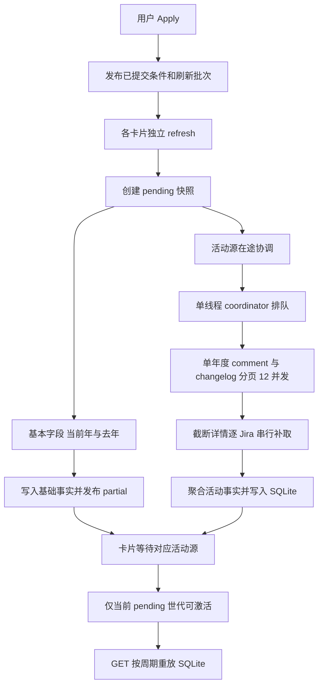

# Jira 页面卡片业务开发基线与优化规划

> 状态：Coco 已确认基线并授权交付；专项优化尚未开始。日期：2026-10-14。需求与验收负责人：Atlas；唯一开发助手：Mason。
> 本文记录已确认需求、当前工作区实现及后续执行清单。本文获确认后，先随当前工作区完成审查、提交、合入主分支及推送；工作区干净后再开展专项优化。本文不代表性能问题已经解决，也不授权现在修改业务实现。

## 1. 目的、范围与阅读约定

目标是在不改变统计口径、授权边界和快照机制的前提下，建立可维护、可测量的 Jira 卡片体系，定位并优化活动数据获取中的 502、跨卡排队和长时间 loading。

- **业务范围**：导航栏 Jira 页面中的 Self-Test、Task、Customer Feedback 卡片及其筛选、统计、异步获取和 SQLite 快照。
- **范围外**：Dashboard 等其他页面、日报、周报、审查、背景动画及其他工作区改动。共享 Core 能力的修改必须评估这些消费者，不能顺带改变其行为。
- **保留原则**：基本字段链路已有验证，尽量保持原行为；不擅自新增业务条件、QA creator/owner 限制、兜底、重试或第二套缓存。
- **事实基线**：本文描述的是当前未提交工作区，不是某个已发布版本。历史设计与本文有差异时，先对照 Coco 最新需求和实际代码，不能以旧文档恢复已删除机制。
- **标记约定**：“已确认需求”为 Coco 的业务要求；“当前实现”为代码事实；“待确认/待验证”为不能直接实施或宣称通过的事项。

本文与执行清单保持在同一文件，不另建实施计划。根目录 `AGENTS.md` 的交付、安全及 ownership 边界仍然适用。

## 2. Coco 已确认的需求

| 编号 | 需求与不可改变的口径 |
| --- | --- |
| R1 | 各卡片有独立业务范围，不先获取公共大集合再由卡片过滤。共享筛选器只发布用户已提交条件。 |
| R2 | 活动查询范围为：年度 created 条件 AND 用户已提交 JQL AND 卡片业务条件。不得加 QA creator/owner 限制；非 QA 创建的 Jira 也可能被 QA 评论或 Verify。 |
| R3 | Self-Test 为 Bug＋Self-Test；Task 为 Task；Customer Feedback 保留既有客户反馈业务条件，不自行简化或扩大范围。 |
| R4 | Comment 按 QA 评论作者计数；Verify 对每个 Jira 取最后一次 Resolved → Verified 的操作者，仅该操作者为 QA 时计数。 |
| R5 | 活动统计的 QA 名单和产品线来自 `core/config/personnel.json`，按人员归属分类，不按 Jira 项目分类。基本字段链路暂保留，来源差异见第 9 节。 |
| R6 | 今年、去年分别获取；展示周期按 Jira 创建时间拆分，不能误写成按评论或 Verify 的发生时间统计。 |
| R7 | 显式 Apply 必须刷新远端。GET 卡片统计只读取 SQLite；周期切换只读前端 payload，二者都不启动远端活动查询。 |
| R8 | SQLite 是事实及查询快照唯一持久 owner；进程内只放任务、进度、取消和在途协调；前端展示缓存不能成为业务范围来源。 |
| R9 | Jira 页面业务 JQL 集中到 `core/jira/jql.py`，条件语法组合继续复用 `compose_jql`。 |
| R10 | 两类取数能力分别为基本字段与 comment＋changelog。当前 4/12 并发参数不等于已经实现全卡共享两个并发池；共享调度设计需明确后再实现。 |
| R11 | 先确认本文并完成工作区交付，干净后再重点优化。Web 服务由 Coco 启动，未经指示不得停止或重启。 |

## 3. 卡片机制与指标

### 3.1 卡片结构

三个卡片共享统计组件、筛选发布机制、任务管理和快照 repository，但分别构建 JQL、执行查询、记录状态与展示结果。当前/上一周期分别有可用性，不能因为基础字段已完成就把 Comment 或 Verify 显示为已完成的零值。

基础层提供创建数量、Invalid、components 等统计；活动层提供 Comment 与 Verify。Customer Feedback 首指标展示 components；Invalid 展示 Total、Invalid 及比例；人员指标由 ranking-card 展示。具体字段及布局沿用当前组件，不在性能优化中重新定义。

### 3.2 基础层：当前实现，暂保留

- `load_fae_qa_roster` 从 Jira 用户组读取 QA：`fae-wifi-qa`、`fae-SH-qa`、`fae-stb-qa`、`fae-tv-qa`、`fae-iptv-qa`。
- 基础查询包含 QA creator 组条件；基础数量按 creator 计数，非 QA creator 不计入基础总量。
- 产品线归属优先采用无线 QA 归属，否则按 Jira project 映射。
- Invalid 当前判断为 `resolution.name == "Invalid"`；不能与客户反馈无线分支的 resolution 排除条件混为一谈。
- components 对单个 Jira 的不同名称去重计数。

上述是基础链路现状，不是将活动查询限制到 QA 创建范围的理由。

### 3.3 活动层：Comment 与 Verify

`load_activity_qa_roster` 读取 `core/config/personnel.json` 中 `FAE-QA.employees`；活动贡献按人员归属产品线统计。

| 指标 | 统计规则 | 必须避免的误解 |
| --- | --- | --- |
| Comment | 遍历查询范围内 Jira 的评论，按 QA 评论作者累计贡献 | 不是按 Jira creator、assignee 或项目归属计数 |
| Verify | 每个 Jira 先找最后一次 Resolved → Verified，再判断操作者是否为 QA；每个 Jira 至多一次贡献 | 不能累计所有历史 Verify，也不能跳过最后一次非 QA 操作后回找更早 QA |
| 周期归属 | 使用 Jira 的 `createdAt` | 不是 comment.created 或状态转换时间 |

当前人员配置中多产品线归属会分别贡献，无归属有 unassigned 计数；此处如实记录，不新增去重、推断产品线或静默丢弃规则。Verify 当前状态匹配与严格口径的差异见第 9 节。

## 4. JQL 的所有权、组合与边界

### 4.1 唯一职责

- `core/jira/jql.py::CARD_BUSINESS_JQL`：卡片业务谓词。
- `core/jira/services/filter_service.py::compose_jql`：交集组合、括号及 ORDER BY 处理，其他层不再拼一套语法。
- `effective_card_jql_pair`：基本字段今年/去年条件组合。
- `activity_card_jql_pair`：活动字段今年/去年条件组合。
- `jira_api.py`：解析认证账号、卡片定义和用户请求，交给已有 owner；不另建隐藏卡片约束。

逻辑表达如下，实际字符串必须由已有组合函数生成：

```text
基本字段有效 JQL = 用户已提交条件 AND 卡片业务条件 AND QA creator 组条件 AND 年度 created 范围
活动字段有效 JQL = 用户已提交条件 AND 卡片业务条件 AND 年度 created 范围
```

用户草稿与 effective JQL 分开保存。校验、远端执行、SQLite 记录要能追溯到同一有效查询，不能查询结束后悄悄加条件或扩大范围。

### 4.2 卡片业务谓词

| 卡片 key | 当前固定业务条件 |
| --- | --- |
| `self-test` | `issuetype = Bug AND "Channel of Reporter" = "Self-Test"` |
| `task` | `issuetype = Task` |
| `customer-feedback` | `issuetype = Bug AND "Channel of Reporter" = "Customer-Feedback" AND (无线分支 OR 标准分支)` |

Customer Feedback 的现有分支必须完整保留：

- 无线标签集合：`Customer_W1`、`Customer_W1U`、`Customer_W2L`、`customer_w2`、`Customer_w1u`、`customer-w2`、`customer-w2L`、`customer_w1d`。
- 无线分支：命中上述 labels；resolution 为空或不在 `Invalid Case`、`Cannot Reproduce`、`HW Fix`、`Won't Fix`、`Won't Do` 中；project 不在 `RD SW Platform`、`Wireless Project` 中。
- 标准分支：project 属于 `core.product_lines.PRODUCT_LINE_BY_JIRA_PROJECT` 的键；labels 为空或不属于上述无线标签。

这些条件由业务 owner 定义，文档不充当另一份运行时配置。条件变更必须同步代码、回归和本文，不能因性能问题删掉筛选限制。

### 4.3 年度获取与展示周期

Web 分别拉取今年、去年的年度数据。GET statistics 从同一有效年度快照一次派生并返回 week/month/quarter/year 四套视图；周期切换只选择前端已有视图，不请求 API、SQLite 或 Jira。

`JIRA_PERIODS` 支持 `week/month/quarter/year`，当前默认 month。`jira_period_ranges` 以本周周一、本月 1 日、本季度首日、本年 1 月 1 日作为本周期起点，到 now 为止；上一周期为上一完整周期，右边界不包含本周期起点。年度远端 JQL 和本地周期边界必须复用现有时间函数，不能在前端新增另一套计算。

需要覆盖跨年上一周期、日期边界和本地事实可用范围；不能以单一“今年”查询代替今年与去年两份来源。

## 5. 页面交互与接口

### 5.1 用户操作流程

| 操作 | 当前流程及契约 |
| --- | --- |
| 进入 Jira 页面 | 可丢弃的账号展示缓存用于首帧，随后 GET 用 SQLite 原位校准；不因重进页面发起活动取数 |
| 修改 Basic/Advanced 或 saved filter | 修改草稿、获取候选或校验；未 Apply 不改变已应用结果范围 |
| 点击 Apply | 验证并发布用户条件/刷新批次，各卡片独立 POST query 刷新最大年度 snapshot；显式刷新不得直接命中旧完成结果冒充远端刷新 |
| 切换周期 | 从卡片已有四周期 payload 本地切换数据与 Current JQL；零 API、无 period preference/reuse |
| 任务运行 | 轮询状态、展示进度和 partial；按年度与数据层 availability 控制指标可用性 |
| 成功 | 当前有效 pending 快照激活，呈现结果；成功零条是 ready 空结果，不是失败 |
| 失败/取消 | 明确显示失败或取消并停止轮询；符合条件的旧有效结果可以保留，不将未知数写成零 |
| 离开页面 | 停止组件轮询；旧异步响应通过 generation 隔离，不能覆盖新一轮页面状态 |
| 筛选器 Reset | **当前只清空控件草稿**，不会自动发布条件或重建快照；与仓库 Reset 契约的差异单列处理 |

前端默认轮询间隔为 800ms。loading 时提供 partial，failed/cancelled 在无新数据时不主动清空已有图；`no_snapshot` 会明确清空。旧 active 结果是否能重放取决于条件、年度 JQL、名单指纹等匹配，不能承诺任意失败都展示任意旧范围的结果。

### 5.2 接口职责

| 接口 | 职责 |
| --- | --- |
| GET `/api/jira/analytics/state` | 恢复已应用共享条件 |
| GET `/api/jira/analytics/fields`、`suggestions` | 字段及输入候选，不是卡片全量查询入口 |
| GET `/api/jira/analytics/saved-filters`、`saved-filters/{filter_id}` | 保存筛选器列表及内容 |
| POST `/api/jira/analytics/validate` | 校验用户条件 |
| POST `/api/jira/analytics/search` | 验证并发布共享条件，不先查公共 Jira 大集合 |
| POST `/api/jira/cards/{card_key}/query` | 仅由显式 Apply 启动该卡最大年度 snapshot 刷新 |
| GET `/api/jira/cards/{card_key}/statistics` | 从 SQLite 有效年度快照一次返回四周期统计、partial 和状态；不启动远端查询 |
| GET `/api/jira/cards/{card_key}/tasks/{task_id}` | 当前真实会话有权读取的卡片任务状态 |
| DELETE `/api/jira/cards/{card_key}/tasks/{task_id}` | 当前真实会话有权取消的卡片任务 |

“GET 只读 SQLite”的核心约束针对卡片统计与结果恢复，不能误写成字段候选/保存筛选器等全部 Jira API 都禁止访问远端元数据。

## 6. 异步链路：当前实现



### 6.1 并发不是全卡共享 4＋12

| 能力 | 当前参数与调度 | 影响 |
| --- | --- | --- |
| 基本字段分页 | Web 每页 100；每个 gateway 自有 4 worker | 多卡 gateway 同时运行可能叠加，不是全局 4 路 |
| 活动分页 | `fields=[comment,created]`，`expand=[changelog]`，每页 1000；单查询新建 12 worker | 12 指单个活动查询内部并发 |
| 活动源协调 | `submit_coordinator()` 的线程池为 1 worker | 不同卡片、年度源按队列执行，后续卡片可能长时间未开始请求 |
| 年度依赖 | 当前年、去年按依赖顺序执行 | 当前年失败可使去年直接依赖失败，不能将其误报为去年也发生远端 502 |
| 截断详情补取 | 分页返回后逐 Jira 补取 | 不属于前面的 12 路分页池，可能增加长尾耗时 |

gateway 先读取首页确定总量，再调度后续分页；最终去重汇集。基础任务和活动源任务可以并行推进，因此基础指标较早可用不意味着活动源已经开始。

### 6.2 完整性、失败与取消

- comment 内嵌结果被截断时，继续通过评论分页接口补齐。
- changelog 不完整时，通过单 Jira 的 `get_issue(..., expand="changelog")` 补取；仍不完整时明确失败，不以不完整历史计算 Verify。
- HTTP 502 原策略为最多 4 次尝试，间隔 0.25/0.5/1 秒；此次规划不把增加重试作为解决方案。
- 已增加分页失败后取消尚未启动 Future 的修复；在途请求仍需结束，因此首个分页失败和整个活动任务终态之间可能仍有延迟。
- pending 失去运行任务时按 interrupted 失败收敛；取消/失败应是终态，不可一直显示 loading。
- comment 与 changelog 共用活动请求，changelog 失败会影响 Comment 和 Verify 两者可用性；是否隔离是待确认设计，不是现有能力。

### 6.3 复用边界

活动源的范围包含有效查询及人员名单指纹；在相同账号、范围、刷新 revision 下可以复用在途任务或对应 SQLite source。不同卡片业务范围通常不同，不能仅因年度相同就共用结果。

新的显式 Apply 必须产生/使用正确刷新批次，不能复用旧完成批次跳过远端刷新。进程内在途索引只协调运行，不保存长期结果；任务结束后清理在途条目。

## 7. SQLite、状态与隔离

| 持久对象 | 用途与 owner |
| --- | --- |
| `jira_analytics_queries` | 已发布条件，active/pending/last 指针，任务 ID 及真实任务会话 |
| `jira_analytics_snapshots` | 有效 JQL、用户条件、卡片、名单指纹、状态与统计 metadata |
| `jira_analytics_snapshot_issues` | 快照与 Jira 成员关系、顺序、current/previous |
| `jira_analytics_facts` | 按快照与 Jira 保存年度统计事实 JSON |
| `jira_issues` 及关联基础事实表 | 由 `JiraIssueRepository` 管理基础 Jira 事实 |

schema 位于 `web/backend/smarttest_web/jira/schema.py`；查询快照生命周期由 `JiraAnalyticsRepository` 管理。活动统计存储的是统计贡献事实，不应将通用 `jira_issue_comments` 表描述为本链路完整原始评论的持久路径，也不能将沙盒响应落盘等同生产入库。

`local_statistics` 只读 SQLite，合并相同 revision 活动源后按 `createdAt` 聚合。`activate` 只允许当前 pending 生效，旧任务不能覆盖新 Apply；失败保留有效 active，展示时仍要检查范围匹配。

当前卡片结果/条件按账号 scope 恢复；任务读取及取消按真实会话＋卡片隔离。跨账号不得复用快照；同账号另一会话能够恢复允许的结果不等于能控制原会话任务。账号退出、撤销及其他页面既有快照策略不能在本轮性能优化中被统一改写。

前端缓存仅用于首帧展示，在账号切换/注销时清理，并由 SQLite 响应校准；不能从中读取审查、导出或批量动作的权威资源 ID。

## 8. 封装能力与维护入口

路径均相对仓库根目录。扩展时先复用对应 owner，不能为了某张卡片再建一套状态、传输或统计流程。

| 文件/能力 | 负责什么 | 不负责什么 |
| --- | --- | --- |
| `core/jira/jql.py` | Jira 页面卡片固定业务谓词 | HTTP、任务、前端状态 |
| `core/jira/services/filter_service.py` | Basic 条件、compose_jql、周期函数与筛选能力 | 第二套卡片业务约束 |
| `core/jira/services/jql_statistics_cards.py` | 卡片定义、年度 JQL pair、名单、年度事实与周期聚合 | Web 任务生命周期、SQLite schema |
| `core/jira/mapper.py` | Jira payload 映射、最后一次 verification 识别 | 卡片请求排队、页面交互 |
| `core/jira/gateway.py` | 复用 Atlassian SDK 请求、字段投影、分页、完整性补取与错误归一 | 卡片页面状态或业务结果缓存 |
| `web/backend/smarttest_web/jira_api.py` | 认证、卡片路由、请求适配、重放与响应 | 重写 Core JQL/计数规则 |
| `web/backend/smarttest_web/jira/analytics_service.py` | 校验、pending、基础/活动源串接、阶段进度、提交结果 | 自建日志、数据库 owner |
| `web/backend/smarttest_web/jira/analytics_tasks.py` | 会话卡片任务索引、活动源在途复用、状态与取消 | 永久事实缓存 |
| `core/async_tasks.py` 与 Web `task_manager.py` | 通用运行任务、worker/coordinator、进度和取消 | Jira 业务谓词；不能随意为卡片改变全部消费者 |
| `web/backend/smarttest_web/jira/analytics_repository.py` | 快照状态、年度事实、本地重放和激活隔离 | 请求远端补数据 |
| `web/backend/smarttest_web/jira/issue_repository.py`、`schema.py` | 基础事实及 schema | 前端展示缓存 |
| `web/frontend/src/jira-filter-builder.js` | 筛选草稿、校验、Apply 发布与控件交互 | 权威查询集合 |
| `web/frontend/src/jira-main.js` | 将已发布条件分发给各卡片 | 公共全量查询 |
| `web/frontend/src/widgets/jira-statistics-card.js` | 缓存首帧、GET 校准、周期、轮询、可用性和终态 | 自行统计或隐式启动远端查询 |
| `core.logging` | 统一日志协议、文件及输出 | 另一套私有 logger 或临时 print |

## 9. 已知差异与待确认项

| 项目 | 当前事实 | 后续处理边界 |
| --- | --- | --- |
| 共享并发 | 基础每 gateway 4；活动串行协调＋单查询 12 | 全卡共享 4/12 是待设计方向，不写成已实现或立即把 coordinator 调大 |
| QA 名单及产品线 | 基础远端组/项目映射；活动 personnel/人员归属 | 基础已验证应先保留；若要统一全部指标来源，必须明确口径和影响后再改 |
| Verify 状态 | `last_verification` 对 casefold 后状态名做子串匹配 | 与严格 Resolved → Verified 可能不同；列为需确认的规则差异，不趁性能优化静默调整 |
| 筛选器 Reset | `jira-filter-builder.js` 只清未提交草稿 | 与 AGENTS 中清除已应用条件并重建快照的契约有差异；仅指此控件，单独确认修复范围 |
| 失败耦合 | comment/changelog 共用请求且年度有依赖 | 是否隔离指标或年度失败，需要确认结果完整性与请求量权衡 |
| 统计性能 | 已有基本字段及小样本验证 | 不等于全量 changelog、补取、生产入库、轮询展示均已验证 |

这些条目不是本轮新增实现清单，不得因本文被提交就自动改变业务行为。具体优化采用第 11 节的证据与决策门槛。

## 10. 性能证据与诊断口径

### 10.1 沙盒基线：必须保留参数差异

固定实验 JQL：

```jql
created >= "2026-01-01" AND created < "2026-10-14" ORDER BY key
```

| 取数字段与参数 | 已报告实验结果 |
| --- | --- |
| CORE_FIELDS＋comment，100 条/页、4 并发 | 约 149,131 唯一 Jira，524 秒 |
| CORE_FIELDS＋comment，100 条/页、12 并发 | 149,693 Jira，394 秒；4 次 502 重试恢复 |
| 仅 comment，1000 条/页、12 并发 | 149,693 Jira，151.5 秒；无失败；响应解码后约 2.04GB |
| comment＋created＋changelog | 只预检今年/去年各 100 条，约 1.03/1.46 秒；没有全量验证 |

151.5 秒包括约 150.93 秒获取及 JSON 解析、0.57 秒作者计数。0.57 秒不代表处理全部原始响应的总成本。上述实验未包含生产 SQLite 入库和 Web 展示，数据条数差异也不能未经核对就视为同一不可变数据集。

证据位置：`build/jira_comment_sandbox/concurrency_experiment.py`、`four_directions.py`、`concurrency_20261014/`、`four_directions_20261014/`、`activity_precheck_20261014.json`。这些是本地实验资料，交付时核对是否被忽略及可复现性，不将本地文件存在当作已纳入版本控制。

### 10.2 已分析的生产运行窗口

2026-10-14 16:27:45 Apply，截至 16:39:42 的历史采样（不是持续更新的当前状态）：

- Self-Test 基础当前/去年分别 5896/6877 条，基础处理完成。
- Self-Test 活动先排队约 172 秒，远端阶段约 311 秒后失败；7 个分页各 4 次尝试仍为 HTTP 502，每页累计约 242 秒，不少单请求约 60 秒后失败。
- Self-Test 去年活动因依赖失败未发起远端查询，不得算作另一组远端失败。
- Customer Feedback 活动排队约 482 秒后启动；采样时已有 51 页成功、51,000 条原始记录，仍有请求在途。这不是完整总数，也不是唯一 Jira 总数。
- 两卡观测到 12 个并行请求峰值。活动尚未入库就失败；本轮没有 SQLite 失败证据，本地读取与聚合在毫秒级。

HTTP 502 与约 60 秒特征不能直接归因到 Jira、代理或网关哪一层。SQLite 保存 `jira_search_failed` 只说明记录了远端任务失败，不说明数据库写入失败。并发请求耗时之和不是墙钟耗时。

### 10.3 日志与后续测量

正式 JSONL：`C:\Users\SH171300-1522\AppData\Local\Amlogic\SmartTest\logs\smarttest.log`；同目录 `smarttest_readable.log` 为可读输出。统一使用 `core.logging`。

已增加 queue/search/aggregate/persist 等阶段、快照关联、分页 offset/page size、尝试次数、HTTP 状态、异常类型和耗时。不得输出凭据、响应正文或 SQL。页级日志与卡片级日志的关联能力需在并行调度优化时核对，不能仅凭时间重叠强行归属失败分页。

后续实验分别测量：排队、请求及 JSON 解析、补取、聚合、SQLite 写入、本地重放、首批指标和最终展示时间。记录成功/失败页数、总量与唯一条数、完整性、响应量的具体测量口径及内存峰值；不混用网络字节、解压字节和解码对象体积。

### 10.4 2026-10-14 首轮沙盒结果（73 个远端请求，仅保留调试记录）

**Coco 已明确：本轮样本太小，不作为性能选型或生产调整依据。后续必须采用 10 万以上实际唯一 Jira 的真实沙盒取数验证；以下数据仅保留为历史调试记录。**

基线提交 `1693903a`。本轮只使用沙盒脚本、隔离 TestClient 数据库与受控前端测试，生产代码未修改，生产 SQLite 只读；Web 已停止，未启动或重启。以下为有界采样，不是全量性能验收。

从实际快照恢复已提交用户条件，复用 `activity_card_jql_pair` 生成三个卡片今年/去年的活动范围。保留生产查询排序，没有另加 ORDER BY；current 含移动的 now 边界，实时数据也在变化，不能称为固定数据集。实际探测使用 gateway 的单页 `search_payload`，未走生产 `_search_full_page` 的四次 502 重试循环。

**六范围单页对照：**每页 100 条，Self-Test 今年取历史失败 offset=5000，其余取 offset=0。每组 comment/activity 返回 ID hash 一致。

| 范围 | 首次响应 total | 仅 comment（秒） | comment＋created＋changelog（秒） |
| --- | ---: | ---: | ---: |
| Self-Test 今年 | 21,300 | 0.789 | 2.610 |
| Self-Test 去年 | 22,954 | 1.086 | 3.746 |
| Task 今年 | 22,196 | 0.478 | 1.764 |
| Task 去年 | 17,998 | 2.028 | 2.597 |
| Customer Feedback 今年 | 61,669 | 0.236 | 0.591 |
| Customer Feedback 去年 | 46,686 | 0.736 | 3.145 |

total 是当时 Jira 响应中的范围总量，不是本轮下载数量，且后续请求中可能变化。

**Self-Test 今年 offset=5000 的同起点嵌套页：**不同页大小代表不同工作量，不能直接用单页耗时判定整范围最优参数。

| page size | comment（秒） | activity（秒） | activity 响应字节 |
| --- | ---: | ---: | ---: |
| 100 | 0.587 | 2.678 | 3,246,456 |
| 200 | 0.696 | 5.237 | 6,676,156 |
| 500 | 1.705 | 13.100 | 17,675,557 |
| 1000 | 2.822 | 28.152 | 36,024,887 |

响应量为 `len(requests.Response.content)`，即 requests 解压后的响应字节，不是网络传输字节或 Python 解码对象内存。请求耗时包含响应及 JSON 解析。另对仅 comment 的同一 1000 条窗口比较：100×10 顺序请求 3.777 秒，1000×1 为 2.517 秒，ID 集合一致；该结果不能直接推广到 changelog。

**活动 100 条/页、同一 1200 条窗口的并发对照：**三个配置顺序执行，每组 12 个请求，ID 集合 hash 一致。

| 并发 | 墙钟耗时 | 失败请求 |
| --- | ---: | ---: |
| 4 | 9.397 秒 | 0/12 |
| 8 | 6.982 秒 | 0/12 |
| 12 | 6.943 秒 | 0/12 |

每组只执行一次，未随机化顺序，可能受服务缓存与负载变化影响；8 与 12 的差异没有统计显著性结论。没有执行 1000×12 的全量或高负载复现。

12 次六范围对照＋19 次页大小/等窗口请求＋36 次并发请求＋6 次完整性补样，共 **73 次全部 HTTP 200**。本轮未复现 502，不能宣布其根因已确定或问题已解决。600 条完整性补样的 comment/history total 均存在，非零 startAt、缺失 total、total 大于已返回数量均为 0；只证明这 600 条样本，不证明全量没有截断或串行补取。

**排队回放：仅离线模型。**输入为六个实测 activity100 页耗时，每卡 current→previous，预算上限 12，但只有三路可能同时执行，因此没有占满预算。

| 模型 | Self-Test 开始/完成 | Task 开始/完成 | Customer 开始/完成 | 全部完成 |
| --- | --- | --- | --- | --- |
| 整份查询串行 | 0/6.357 秒 | 6.357/10.718 秒 | 10.718/14.454 秒 | 14.454 秒 |
| 卡片之间共享执行 | 0/6.357 秒 | 0/4.361 秒 | 0/3.736 秒 | 6.357 秒 |

模型把实测获取＋解析时长视为常量，没有模拟共享竞争、重试、SQLite、聚合或新增调度开销；它演示起跑等待，不代表生产每卡 12 路分页的真实吞吐。没有运行真实多卡共享调度，也不能据此推算全量加速比。

**交互范围矩阵：**运行现有三个后端测试文件 58 项及三个前端文件 38 项，均通过。以下测试名可在对应文件中检索。

| 操作 | 验证结论/限制 | 直接证据 |
| --- | --- | --- |
| Apply 和卡片范围 | 共享条件只发布，各卡独立查询 | `test_public_search_only_publishes_conditions_and_card_queries_its_own_effective_scope` |
| 再次 Apply、失败 | 刷新活动源；匹配旧结果可保留 | `test_each_explicit_apply_refreshes_activities_and_failure_keeps_prior_result` |
| 周期切换 | 前端本地切四周期数据与 Current JQL，零 API | `switches all four local period views without another API request` |
| Basic/Advanced | 切换保留 builder JQL，编辑后按实际草稿处理 | `switches builder jql back losslessly until advanced text is edited` |
| saved filter | 加载为草稿，Search 才发布 | `loads saved filter as advanced draft without searching and Search publishes conditions` |
| 指标/产品线 | 本地切换指标、产品线和排序结果 | `switches four metrics and product lines with sorted horizontal ranking data` |
| Reset | 仅清草稿，不重建已应用快照；第 9 节差异仍存在 | `publishes conditions once on Search, never queries on restoration, draft edits or Reset` |
| 重进/账号恢复 | 展示重放并由 SQLite 校准，无远端取数 | `reuses the same card display on any page and calibrates it from SQLite`；`test_same_account_relogin_restores_conditions_and_card_without_remote_fetch` |
| 失败/取消 | 保留图，提示失败；取消停止轮询 | `keeps the graph and reports a background failure instead of clearing it`；`stops polling after cancellation without removing its last display` |
| 快速 Apply | 额外沙盒测试 1 项通过：新快照生效、SQLite 条件正确、旧 task API 返回 404；释放旧请求后使用固定短等待，**未确定等待旧 runner 完全收尾，不作为完整晚完成竞态证明** | 沙盒 `test_rapid_apply_old_completion_cannot_replace_latest` |
| 真实浏览器按钮 | 未测，Web 未运行；不能把受控测试等同真实浏览器验收 | 未启动/重启服务 |

证据位于 `build/jira_comment_sandbox/diagnosis_20261014/`（Git 忽略目录，本地可用，不随业务文档提交）：`probe.py`、`requests.jsonl`、`equal_window.json`、`concurrency.json`、`replay.py`、`schedule_replay.json`、`backend.xml`、`frontend.json`、`test_rapid_apply.py`、`rapid_final.log`。probe 依赖当前机器的安全凭据 owner 及原快照，不是脱离环境即可执行的独立数据集；文件不保存凭据和评论正文。

本轮仅观测到大页增加单请求响应量与耗时，未确定历史 502 的具体上游原因。小样本与离线模型均不作为性能选型依据；参数与共享调度调整等待 10 万以上实际唯一 Jira 的真实实验。生产参数、重试、业务条件、Reset 和取消机制均未修改。

### 10.5 2026-10-14 大样本真实取数（192,832 个唯一 Jira）

Coco 要求提升到 10 万以上实际样本后，完成以下两组真实远端实验。基线仍为 `1693903a`，生产实现及生产 SQLite 未修改，服务未重启。Mason 执行、Atlas 验收。小样本不参与本轮性能选型判断。

两组均复用三个卡片今年/去年的业务 JQL、`fields=[comment,created]`、`expand=[changelog]`、原四次尝试重试和完整性补取 owner。用户提交 JQL 为空，created 上界冻结为 `2026-10-14 18:38`，按 `key ASC` 排序；该本地时间字符串由 Jira 账号时区解释，未独立核实时区一致。A 先运行、收尾后运行 B，各一次。

| 指标 | A：1000 条/页、单范围 12 并发、范围串行 | B：100 条/页、全局 12 并发、跨卡公平调度 |
| --- | ---: | ---: |
| 总耗时 | 1153.334 秒（19 分 13 秒） | 904.507 秒（15 分 4.5 秒） |
| 实际唯一 Jira | 144,457，未完整 | **192,832，六范围完整** |
| 成功页 / 最终失败页 | 146 / 14 | 1930 / 0 |
| HTTP 200 / HTTP 502 | 146 / 73 | 1930 / 0 |
| 实际最高 HTTP 并发 | 12 | 12 |
| 沙盒进程 RSS 峰值 | 996,904,960 bytes | 181,927,936 bytes |
| 解压后响应总字节 | 4,415,286,243 | 6,474,528,168 |
| 完整性补取请求 | 0 | 0 |

响应量为 `len(requests.Response.content)`，不是线上传输字节或解码对象内存。A 的 73 次 502 耗时为 60.069–60.207 秒，中位 60.073 秒；最终失败页累计四次尝试约 242 秒。该集中时间特征不能确定 Jira、代理或网关哪一层失败。A 失败位置：Customer 今年 offset 3000、4000、6000、7000；去年 offset 3000–12000（步长 1000）。

| 范围 | A 实取 / 首次 total | B 实取 / 首次 total | A 开始→首批→结束（秒） | B 开始→首批→结束（秒） |
| --- | ---: | ---: | --- | --- |
| Self-Test 今年 | 21,305 / 21,305 | 21,305 / 21,305 | 0→28.716→134.258 | 0→4.080→275.346 |
| Self-Test 去年 | 22,954 / 22,954 | 22,954 / 22,954 | 134.258→166.500→335.464 | 275.404→282.217→562.725 |
| Task 今年 | 22,200 / 22,200 | 22,200 / 22,200 | 335.464→344.056→428.937 | 0→0.932→258.715 |
| Task 去年 | 17,998 / 17,998 | 17,998 / 17,998 | 428.938→439.106→520.920 | 258.715→260.258→477.715 |
| Customer 今年 | 55,000 / 61,690，失败 | 61,689 / 61,689 | 520.920→549.274→808.193 | 0→5.393→617.552 |
| Customer 去年 | 5,000 / 46,686，失败 | 46,686 / 46,686 | 808.193→846.348→1153.312 | 617.552→622.682→904.489 |

时间相对各组启动，首批指第一份远端分页返回，不代表 UI 已展示指标。B 三卡立即获得执行机会，消除 A 中 Task 335 秒、Customer 521 秒的起跑排队；共享预算也使 Self-Test 两年度完成从 335 秒延后到 563 秒，不能概括成所有卡片都加速。

**完整性验收：**B 各范围首次/最小/最大 total 与实取唯一数量一致，scope 内重复为 0；全部记录的 comment/history total 均存在、返回数量一致，无不完整记录，共 1,744,958 条 comment、3,731,716 条 history。A 成功页也通过相同记录级检查，但整范围完整性失败。A 的 144,457 个 ID 全部包含于 B，B 多取 48,375 个；前四范围 ID 集合完全相同。Customer 今年跨组 total 减少 1，交集中 195 条创建时间/评论数/历史数压缩事实变化，说明冻结 created 上界不等于服务器时间点快照。

**解释边界与后续决策：**

- B 同时改变页大小与调度，是组合方案验证，不能单独归因；A 不完整，不能用两组总耗时计算等工作量加速比。顺序单次实验、服务器负载及并存 Web 服务影响未被控制。
- 两组均流式处理并写沙盒 SQLite，A 不是生产整批驻留的完整复刻；失败范围后继续去年以覆盖样本，也不同于生产依赖失败行为。
- 沙盒保存 ID 哈希及创建时间、评论数、历史数压缩事实，不执行 QA 作者归类、最后 Resolved→Verified 聚合、生产 SQLite 快照和浏览器展示。总耗时不能作为端到端卡片 SLA；本轮不支持全量 3–5 分钟完成结论。
- 本轮支持将“小页＋共享预算”作为后续候选，但未证明 100 是最优页大小，也未证明 502 永久消失。生产改动需 Coco 确认；若需隔离变量，后续保持同一调度，仅比较页大小，再单独比较调度。
- 按钮范围切换仍只有 10.4 所列受控逻辑测试证据，本轮大样本不增加真实浏览器交互验收结论。

证据位于 `build/jira_comment_sandbox/fullscale_20261014/`（Git 忽略、本地保留）：`run.py`、`manifest.json`、`A_summary.json`、`B_summary.json`、`attempts.jsonl`、`pages.jsonl`、`progress.jsonl`、`audit.json`、`facts.db`。脚本依赖本机安全凭据 owner，不保存凭据或评论正文。`run.py selfcheck`、`selfcheck.py`、`run.py A`、`run.py B`、`analyse.py` 均退出 0；A 退出 0 只代表采集正常收尾，其业务完整性为 FAIL，B 为 PASS。

### 10.6 固定共享 12 并发，对比 100／200／500 条分页

Coco 授权继续全量对比。C=200 条、D=500 条，均复用 B 的跨卡公平调度、每卡今年→去年依赖、相同查询 hash、18:38 冻结边界、字段及重试策略，C 完成后才启动 D。生产代码、生产 SQLite 和服务均未修改。

首次 C 的沙盒组名适配遗漏了 cursor 轮转条件，被判无效并独立终止；记录隔离于 `pages_200_500_20261014/INVALID.json`，不参与以下统计。修正后与原脚本只有页大小映射、将轮转条件从 B 扩展到所有非 A 组两处差异。强化自检使用相同模拟页数验证 B/C/D 调度轨迹完全一致、持续轮转及年度依赖，退出 0；有效运行保存在新目录。

| 指标 | B：100 条 | C：200 条 | D：500 条 |
| --- | ---: | ---: | ---: |
| 实际唯一 Jira | 192,832 | 192,830 | 192,830 |
| 耗时（秒） | 904.507 | 901.077 | 842.894 |
| HTTP 200 / 502 | 1930 / 0 | 966 / 0 | 388 / 0 |
| 重试 / 最终失败页 | 0 / 0 | 0 / 0 | 0 / 0 |
| RSS 峰值（MiB） | 173.5 | 229.8 | 526.1 |
| 解压响应总字节 | 6,474,528,168 | 6,474,862,703 | 6,475,463,645 |
| 严格范围数量一致 | PASS | **FAIL：运行中 total 变化** | PASS |

C/D 实际最高并发均为 12，补取均为 0，返回的 comment/history 数量完整性检查均通过。C 的 Customer 今年 total 从 61,689 降至 61,687，实取 61,687，因此严格范围一致标记 false；这不是 HTTP 失败或活动字段截断。D 六范围实取与各自首次/最小/最大 total 一致。

| 两年度均完成时间（秒） | B：100 条 | C：200 条 | D：500 条 |
| --- | ---: | ---: | ---: |
| Self-Test | 562.725 | 559.772 | 570.357 |
| Task | 477.715 | 430.987 | 371.024 |
| Customer Feedback | 904.489 | 901.061 | 842.878 |

三卡今年第一份分页返回时间：B 为 4.080／0.932／5.393 秒，C 为 8.094／1.726／11.338 秒，D 为 20.099／3.586／32.120 秒。顺序为 Self-Test／Task／Customer；仅表示远端首批，不代表界面指标可见。大页减少请求数，但增加首批等待和内存，本次也未使所有卡片都更快。

集合核对：C/D 分别是 B 的子集，各少 2 个 ID、无新增；C 与 D 交集为 192,829，各独有 1 个 ID，差异都在 Customer 今年。C/D 相对 B 分别有 234／438 条交集压缩计数事实变化。不能因总数相同就认定数据集完全相同，也不能把范围数量一致等同服务器时间点快照。

本轮观测到 200 与 100 总耗时接近；500 比 100 少约 62 秒，但 RSS 约为其 3 倍，Self-Test 两年度完成略晚。三组各顺序运行一次，受服务器缓存、负载和实时数据变化影响，尚无稳定收益或最优页大小结论。100／200／500 本次均未复现 502；不能由此宣布 502 永久解决。上一轮 A 同时使用串行调度与 1000 条分页，不能将其失败完全归因到页大小。

下一步讨论以稳定性、首批等待、内存及总体时间共同选择候选；本轮不自动变更生产参数。QA 聚合、生产 SQLite 快照、真实浏览器交互和端到端耗时仍不在本次远端分页实验验收内。

有效证据：`build/jira_comment_sandbox/pages_200_500_valid_20261014/` 的 `run.py`、`selfcheck.py`、`manifest.json`、`provenance.json`、`C_summary.json`、`D_summary.json`、`attempts.jsonl`、`pages.jsonl`、`progress.jsonl`、`audit.json`、`facts.db`。本机忽略目录，不随 Git 提交。有效 C/D 和分析脚本退出 0，C 严格范围一致性仍按 FAIL 如实报告。

### 10.7 完整卡片后端业务链路：真实获取、生产统计、SQLite 与卡片 GET

Coco 授权在沙盒复用生产处理逻辑，固定 100 条分页、共享最多 12 请求并发、真实 10 万以上活动样本，分别记录各阶段耗时。此次单轮完整执行至卡片可用响应，生产代码和生产 SQLite 未修改，服务未重启。

**复用链路与实验边界：**

- 必需的基本字段先执行六个年度范围，经原 `JiraIssueMapper`、`build_annual_facts`、`load_fae_qa_roster` 和 repository `write_batch`；每范围最多 4 并发，同时受全局 12 预算限制，实测每范围峰值 4、全局峰值 9。
- 再执行活动六范围：`search_activity_payloads` 原完整性补取 → `build_annual_facts` 按 QA 评论作者及每 Jira 最后一次 Resolved→Verified 构建事实 → `JiraAnalyticsRepository.update_statistics/activate` 写独立 source → `local_statistics` 合并并执行原 `aggregate_annual_facts`。活动实际峰值并发 12，不加 QA creator/owner 限制。
- 使用生产 effective/activity JQL owner，把 `created <= "2026-10-14 18:38" ORDER BY key ASC` 作为显式用户条件，供查询和真实 GET 匹配。名单和产品线沿用生产 owner。此运行的动态数据不同于前几轮，不能按耗时直接推导提速比例。
- 沙盒逐页调用生产统计，按原页顺序重放事实后交给生产 repository；无另写统计算法。整批/逐页等价自检及年度依赖/共享预算自检通过。为保持顺序引入的沙盒暂存、重读开销单独记录。
- 分阶段 basic→activity 和共享调度属于沙盒编排，未运行生产 Apply 任务生命周期，也未进行浏览器渲染验收。没有修改生产协调线程池或分页参数。

**全量结果：**基本字段 15,531 唯一 Jira，活动 192,829 唯一 Jira；十二个范围内实取/首次/最小/最大 total 一致、无重复。活动包含 1,745,326 条 comment、3,733,346 条 history，返回数均等于声明 total，无缺失或截断、无需补取。基本字段 342 次 HTTP 200（157 分页＋185 人员组请求），活动 1930 次 HTTP 200；无 502、无重试。活动阶段沙盒进程 RSS 峰值 324,501,504 bytes（约 309.5 MiB）。

总墙钟 **833.941 秒（13 分 53.9 秒）**，包含基本字段 23.769 秒、活动 803.478 秒、初始化及末尾真实接口验证等。三卡首次从生产 `local_statistics` 读取可用数据的时刻（相对整轮启动）：Task 453.250 秒，Self-Test 529.129 秒，Customer Feedback 827.605 秒；对应本地读取＋聚合分别为 0.215／0.513／0.809 秒。

| 阶段 | 基本字段 | 活动数据 | 计时口径 |
| --- | ---: | ---: | --- |
| 获取：请求累计 | 80.593 秒 | 9431.883 秒 | 各 `session.request` 到响应 body 到达的耗时相加，包含服务器等待与传输，不是独占墙钟 |
| 获取：请求区间并集 | 22.900 秒 | 801.153 秒 | 至少一个请求在途的墙钟覆盖，可能与解析、聚合、写入重叠 |
| JSON 解析 | 0.338 秒 | 32.976 秒 | 实际 `Response.json` 调用累计，未把整个 fetch 误称解析 |
| 业务事实计算 | 0.721 秒 | 3.706 秒 | 生产统计调用累计，基本层扣除嵌套网络、JSON、mapper及锁等待；非CPU时间 |
| mapper | 0.388 秒 | 0 | 基本字段原 mapper 调用累计 |
| SQLite 页级写入 | 3.199 秒 | 2.350 秒 | 原 repository 调用累计，包含业务存储方法内部工作 |
| SQLite 年度收尾 | 0.269 秒 | 1.504 秒 | 原事实写入、source 激活、元数据更新累计 |
| 沙盒事实暂存 | 0.470 秒 | 5.157 秒 | 额外编排成本，不算生产 repository 写入 |
| 沙盒事实重读 | 0.140 秒 | 1.005 秒 | 额外编排成本，包含暂存事实 JSON 还原 |

三卡激活另计 0.011 秒，生产 SQLite 写入/收尾/激活合计约 **7.333 秒**。基本字段统计 owner 累计 93.574 秒，其中人员组查询约 36.244 秒、聚合锁等待累计 56.219 秒；不能把这个含等待的值当作纯计算。并发累计、区间并集及总墙钟是不同口径，上表不能直接相加；SDK 文本处理、完整性检查、调度与记录开销也未强行归入 JSON 解析。

**卡片响应验收：**重开隔离 SQLite，走真实 FastAPI `/api/jira/cards/{card}/statistics` 路由，验证三卡 × 年/季/月/周共 12 个 GET，均 HTTP 200、`state=ready`、basic/activity availability 全部 true，固定产品线结构及人员指标字段正确。验证期间禁止远端，实际远端调用 0。12 次 GET 总耗时 5.607 秒，单次 0.200–0.738 秒；其中原周期聚合函数累计 0.308 秒，剩余包括 SQLite 读取、事实解码、合并及响应组装。隔离库有 9 个有效快照、208,360 条事实、15,531 条基本 issue。

因此本轮已完成“获取→生产统计→SQLite→卡片可用响应”的后端验收；活动请求在途覆盖约 801 秒，是本次耗时主要部分。这里的获取包含服务端处理等待，不足以单独断言网络带宽或 Jira 服务端哪一项主导。SQLite 和业务统计不是本轮分钟级等待的主要来源。单次运行及非时间点快照的限制仍保留，不宣称生产改动已完成或线上 SLA 已验证。

证据：`build/jira_comment_sandbox/business_chain_20261014/` 中 `run.py`、`business.py`、`manifest.json`、`audit.json`、`chain_summary.json`、`basic_summary.json`、`activity_summary.json`、`business_timings.jsonl`、`attempts.jsonl`、`parse.jsonl`、`card_ready.jsonl`、`http_checks.json`、`cards.db`。目录被 Git 忽略；原始评论正文不落盘。首次自检导入日志 owner 曾向默认日志写入合成诊断，正式全量前已定向沙盒日志；不混入正式计时。自检、调度检查、正式执行和分析均退出 0，生产代码净增长 0。

### 10.8 获取字段拆分：comment 与 changelog 的全量匹配对照

Coco 要求定位“旧仅 comment 约三分钟，而活动组合需十三分钟”的获取原因。本轮只测获取、解析和完整性，不重复基本字段或卡片聚合；生产代码、数据库和服务不变。四组顺序执行，使用同样六个卡片年度范围、冻结边界、排序、账号及跨卡共享 12 并发，每卡今年→去年；实际唯一 Jira 均为 **192,829**，四组 ID 集合 hash 完全一致。内容仍会动态变化，非时间点快照。

先核对旧实验：`four_directions_20261014/metrics.json` 的 `full_12` 为 149,693 唯一 Jira，单一今年全局查询（创建于 2026-01-01 至 2026-10-14 零点，无卡片谓词）、仅 comment、1000 条/页、12 并发、150 请求全部 200、解压约 2.044 GB；总 151.496 秒，其中获取 150.930 秒、作者计数 0.565 秒。与新六范围的样本、年份、字段和分页不同，不能直接归因。

| 本轮组别（均含 created） | 每页 | 请求数 | 总墙钟 | 解压响应量（十进制 GB） | JSON 调用累计 | RSS 峰值 MiB |
| --- | ---: | ---: | ---: | ---: | ---: | ---: |
| 仅 comment | 100 | 1930 | 214.043 秒 | 3.067 | 13.009 秒 | 206.6 |
| 仅 changelog | 100 | 1930 | 791.302 秒 | 3.454 | 17.529 秒 | 122.9 |
| comment＋changelog | 100 | 1930 | 855.726 秒 | 6.478 | 30.494 秒 | 181.2 |
| 仅 comment | 1000 | 195 | 138.686 秒 | 3.067 | 13.732 秒 | 820.8 |

各组实际最高并发均 12，HTTP 全部 200，重试、最终失败、补取均 0；六范围实取与首次/最小/最大 total 均一致。单字段组仅验证请求字段，不把未请求字段当作已取完整。为复用原补取 owner，未请求字段只在隔离适配层临时提供空完整块，不计入原始响应字节、计数或完整性结论；字段及截断补取自检、四组持续轮转自检均通过。

| 获取单请求耗时 | comment 100 | changelog 100 | 组合 100 | comment 1000 |
| --- | ---: | ---: | ---: | ---: |
| P50 | 1.259 秒 | 4.837 秒 | 5.205 秒 | 7.762 秒 |
| P95 | 1.996 秒 | 8.181 秒 | 9.406 秒 | 12.236 秒 |
| P99 | 3.558 秒 | 9.354 秒 | 11.522 秒 | 21.185 秒 |
| 最大 | 5.156 秒 | 11.441 秒 | 13.833 秒 | 29.509 秒 |

获取计时为 `session.request` 到 body 接收完成，包含服务端等待、传输和解压；JSON 为真实 `Response.json` 调用累计，不能与并发墙钟直接相加。白名单 `X-Runtime`、`X-Response-Time`、`X-Envoy-Upstream-Service-Time` 本轮均未返回，尚无服务端阶段耗时证据。

**本轮可支持的定位：**

- 同范围、100 条分页、相同请求数下，仅 changelog 为仅 comment 的约 3.70 倍耗时；组合为约 4.00 倍。仅 changelog 的墙钟已相当于组合的 92.5%，说明主要慢项关联 `expand=changelog` 获取，不是必须同时带 comment 才产生的现象；92.5% 是两次实验比值，不是组合请求内部时间分解。
- 仅 changelog 的解压响应量仅为仅 comment 的约 1.13 倍，但单请求 P50 为约 3.84 倍。解压字节量不足以单独解释差距；仍未测压缩线上字节、首字节等待与 body 下载耗时，不能因此确定为 Jira 数据库/历史展开或某层代理。
- 三个 100 条组均无重试、补取，且使用同一共享调度；JSON 累计差距为十几秒，不足以解释约十分钟墙钟差距。上一轮已验证生产聚合及 SQLite 非主要瓶颈，本轮将慢点进一步收窄到 changelog 请求等待与接收阶段。
- 仅 comment 从 100 条改 1000 条，本次减少约 35.2% 墙钟（214.043→138.686 秒），证明旧三分钟成绩也受页大小影响。但内存峰值增至约 821 MiB，且该收益不能直接推广到 changelog 大页。
- 四组顺序各一次，ID 集合一致但评论/历史仍增长，缓存及服务端负载未控制。以上是可复核关联，不宣称最优参数或服务端根因已确定，也不因结果自动拆分生产请求或改变业务。

后续若继续定位，应在保持匹配样本与并发条件下分开首响应等待、body 接收、线上压缩字节和解析计时；必要时结合 Jira/代理服务端请求诊断，才能判断服务端展开历史与网络传输的贡献。本轮未执行这一步。

证据目录 `build/jira_comment_sandbox/fetch_split_20261014/`（本机 Git 忽略）：`run.py`、字段/调度自检、`manifest.json`、四组 summary、`audit.json`、请求/解析/分页/进度记录与隔离事实库。正式四组运行和分析退出 0。四组请求字段完整性通过，实际返回数：comment100 为 1,745,401 条 comment；history100 为 3,734,058 条 history；组合为 1,745,514 条 comment、3,734,421 条 history；comment1000 为 1,745,537 条 comment，均等于各响应声明 total。

### 10.9 当前 Jira 获取能力核对：只取 Verify 所需信息是否可行

Coco 明确停止并发、分页和分段性能调参，改为先核对服务实际支持的取数方式。本轮仅 23 个低量只读请求（含 serverInfo），无全量性能实验，生产代码和 SQLite 未改。

`GET /rest/api/2/serverInfo` 确认 **Jira Server 8.9.1 / build 809001**，SDK `atlassian-python-api 4.0.7`、`cloud=false`。核对[该版本官方 REST 文档](https://docs.atlassian.com/software/jira/docs/api/REST/8.9.1/)：issue/search 的 `expand=changelog` 返回变更历史，`fields` 选择 issue 字段，没有文档化的 status-only 历史过滤或最后转换操作者投影。Cloud 的[批量 changelog fieldIds 接口](https://developer.atlassian.com/cloud/jira/platform/rest/v3/api-group-issues/)不属于当前部署能力，不能直接套用。

| 获取方式 | 当前证据 | 能否替代现有 Verify 获取 |
| --- | --- | --- |
| issue/search 展开 changelog | 当前可用，返回含非状态变化的完整历史 | 保持现有方式；未找到服务端仅返回状态项参数 |
| SDK `get_issue_status_changelog` | Server 分支仍先取完整 changelog、本地筛 status，输出不保留 author | 不能减少远端成本，也不能直接满足最后操作者口径 |
| 独立 `/rest/api/2/issue/{issue}/changelog`、v3 同路径 | 同一个已确认可见 issue 的两次请求均 404；当前版本文档无对应支持 | 当前部署未确认可用；不把两个 404 推断为所有插件接口都不存在 |
| JQL `status CHANGED` | 六范围均支持；count 合计 192,829→160,091 | 可作为必要条件候选预筛，但仍需完整历史判最后操作者；只少约 17%，未验证性能收益 |
| `status CHANGED FROM Resolved TO Verified` | 六范围均支持；count 合计 125,970 | 只能表示曾发生转换，不能直接当最终 Verify；且与当前 mapper 包含匹配不等价 |

[官方 CHANGED 语义](https://confluence.atlassian.com/jirasoftwareserver/advanced-searching-operators-reference-939938745.html)是查找发生过指定变更的 issue，不返回最后匹配事件的操作者。不能先按 QA 的 `BY` 缩窄历史后取最后，也不能用当前 status、issue updated 时间替代事件判断。

**已发现的口径边界：**当前状态 metadata 含 `Resolved`、`Verified`、`QA VERIFIED`。生产 mapper 对 from/to 名称做包含匹配，精确 `TO Verified` 不是已证明等价的预筛；仅枚举当前状态也不能覆盖历史名称变更。此次只报告，不修正或收紧生产规则。更宽 `status CHANGED` 在语义上可保留任何状态转换候选，但未做全量索引召回验证，不能宣称已完成生产替代验收。

3 条真实 issue 的历史分别为 17／15／20 条，均完整且含非 status 项；下载后只保留 status 项，再运行原 `last_verification`，结果一致。这只证明小范围本地投影的正确性，不证明服务端能过滤，也不是性能证据。原业务口径仍必须检查每个 Jira 最后一次匹配转换，再判断操作者是否 QA。

**结论与下一步讨论：**目前未确认无需改变服务端即可“只取 Verify 最终信息”的原生捷径，不继续用参数实验争取有限收益。`updated` 增量可减少后续重抓，但必须处理首次全量、查询范围移出、删除/权限变化、历史修正、名单变更等完整性边界，不是当前已验证方案。若以后需要服务端自定义索引/插件来直接提供最后转换及操作者，那是新的服务器能力与维护范围，未获授权、未实施。

Coco 提出的机制方向是 changelog 定期后台更新，用户不能随时触发；1 小时或 3 小时尚未选择。后续在本文讨论并确认：账号/卡片/已提交 JQL 对应的刷新范围、新范围首次数据、任务合并和不重叠、旧有效快照保留及更新时间、失败后的展示、Apply 与 Comment/Verify 刷新边界。SQLite 仍为唯一持久 owner。此方向与当前“显式 Apply 必须刷新远端”的 changelog 行为不同，需要确认具体设计后实施；本轮不创建定时任务、不改变按钮行为。

证据：`build/jira_comment_sandbox/verify_capabilities_20261014/` 的 `server.json`、`capabilities.json`、`probe.py`、`run.log`；只保存版本、状态、schema、计数和结果相等布尔值，不保存凭据、issue 或人员正文。共 21 个 HTTP 200、2 个预期能力探测 404；已停止远端请求。

## 11. 优化方向与同文档执行清单

### 11.1 阶段 A：先交付当前基线

- [x] Coco 审阅本文，确认需求、现状差异与后续范围（2026-10-14 已授权整理工作区并提交）。
- [x] 按根目录 AGENTS 审查完整工作区，包括既有修改和未跟踪文件；未发现需删除的临时/失败实现，保留正式日志与必要测试。
- [ ] 运行全部受影响范围验证及 `git diff --check`；按业务关注点拆分原子提交。
- [ ] 将有效工作与本文交付主分支并推送配置远端；确认 `git status --short`、`git diff`、`git diff --cached` 均为空。

本文确认是当前基线交付的前置条件；本次写文档不提前执行提交、合并或 push。

2026-10-14 基线交付验证：后端及相关 Core/日志/边界测试 431 项通过；前端 294 项通过；lint、build、产品边界检查及 diff check 通过。Chrome 源环境完成点击、长图滚动与背景覆盖检查，无捕获的浏览器错误；未完成持续帧率验收。上述验证不代表远端 502 或活动排队问题已解决。提交与推送结果以本次 Git 交付记录为准。

### 11.2 阶段 B：验证稳定单页负载

优先在同一实际失败范围、相同年度和可定位分页位置比较，而不是换成全局沙盒 JQL 宣称解决了卡片问题。

- [ ] 记录实际有效查询、可复现实验窗口、排序与基准 offset；结果数据变化和不同页大小覆盖范围必须说明。
- [ ] 比较仅 comment 与 comment＋created＋changelog；各比较每页 100/200/500/1000，保持其他变量一致，避免一次叠加多组负载。
- [ ] 对照 502 比例、耗时分布、响应量、评论/历史完整性与补取量；给出失败页可复现证据。
- [ ] 基于结果选择稳定单页负载，写回本文的参数结论和验收依据；不直接提高总并发或增加重试掩盖失败。

本阶段是建议实验顺序，不承诺 151.5 秒为生产 SLA。明确实验执行范围后再访问远端，不因文档编写启动压测。

### 11.3 阶段 C：确定调度与补取方案后实施

| 方向 | 价值 | 必须明确的代价/边界 |
| --- | --- | --- |
| 稳定 page size 与字段负载 | 优先减少单页约 60 秒失败 | 页数增加的开销及完整性不能忽略 |
| 所有卡片共享基本字段 4、活动 12 的预算 | 避免每卡倍增请求，让不同卡片分页使用同一额度 | 预算是账号级还是进程级、公平性、年度依赖、取消与共享 source 生命周期须明确；基本链路变更应有证据支持 |
| 将截断补取纳入有界活动预算 | 缩短串行补取长尾 | 不得在 12 路外再创建无上限补取池；仍须验证历史完整性 |
| 分离 comment/changelog 的失败或获取 | 可减少一个指标失败拖累另一个 | 可能增加请求/解析和持久化成本，需实验后由 Coco 决定是否采用 |

- [ ] 在本文补齐选定方案的作用域、接口、任务生命周期、取消/失败语义及净代码增量评估，取得 Coco 对具体方案的确认。
- [ ] Atlas＋同一个 Mason 实施已确认方案；复用现有 gateway、任务、repository、SDK 和日志 owner，不新增平行机制。
- [ ] 用回归测试保护现有基础指标、统计口径与快照隔离；删除临时探针、无效方案和实现形状断言。
- [ ] 完成真实 Web Apply 验证，记录端到端耗时和失败率，再判断性能是否达到约定目标。

对同一份已确认具体设计与执行清单不重复索取设计复审或执行方式选择。实验后产生的新并发边界、业务口径变化或范围扩展，必须先补充证据与决策，不能把候选方向当成已批准实现。

## 12. 验收标准与验证入口

| 验收领域 | 必须证明的行为 |
| --- | --- |
| 卡片范围 | 三卡业务谓词和用户条件独立；活动不加 creator/owner 限制；基本范围不被无意改变 |
| Comment/Verify | 非 QA 创建但 QA 评论/Verify 可计入；最后一次非 QA Verify 不回找旧 QA；历史截断不会伪造完整统计 |
| 人员/周期 | 活动按 personnel 作者与产品线；created 周期及跨年边界正确；不按活动发生时间切分 |
| 刷新/重放 | 再次 Apply 真正刷新；GET 无远端活动请求，周期切换零 API；相同批次合理复用、不同批次不误用旧完成源 |
| 隔离/竞态 | 跨账号隔离、真实会话任务授权、旧任务不可覆盖新 pending、失败不发布不完整结果 |
| UI 终态 | 基础 partial 与活动 availability 分开；零条 ready；failed/cancelled/interrupted 明确且停止轮询 |
| 并发/取消 | 实测所选预算上限；取消未启动任务、在途收尾和共享使用方语义正确；不因等待依赖占尽全部工作槽 |
| 性能/质量 | 分阶段测量真实全量；无私有缓存/日志/传输 owner，无临时诊断和失败尝试残留 |

主要验证文件：

- `core/testing/self_tests/shared/test_jira_gateway.py`
- `core/testing/self_tests/shared/test_jira_jql_statistics_cards.py`
- `web/backend/tests/test_jira_analytics_api.py`
- `web/backend/tests/test_jira_analytics_repository.py`
- `web/backend/tests/test_jira_analytics_service.py`
- `web/backend/tests/test_jira_card_replay.py`
- `web/frontend/tests/jira-statistics-card.test.js`

后续修改按影响范围运行这些回归、完整 Web 后端与前端必要验证；日志相关修改另遵循 logging 技能及产品边界检查。当前文档编写不重新运行业务测试，不沿用历史通过数宣称最新性能通过。

**交付需要分别报告 Functional Acceptance 与 Code Quality。** 单元/集成测试通过不替代真实全量 comment＋changelog、生产 SQLite 和 Web 展示验证；远端环境不可用时明确报告未验证部分。

## 13. 相关资料与维护约定

- [根目录 AGENTS](../../AGENTS.md)：角色、交付、SQLite 与快照边界。
- [Jira 领域说明](README.md)：Core 集成职责；本卡片链路以本文具体说明为准。
- [页面过滤器与卡片查询边界](../../docs/superpowers/specs/2026-08-31-global-async-task-manager-design.md)：独立卡片、任务及结果恢复机制；历史具体口径需与最新确认需求核对。
- [Web 缓存与数据库边界](../../docs/superpowers/specs/2026-09-01-web-cache-database-boundaries-design.md)：事实、快照、展示缓存与动作范围。

旧 `docs/architecture/JIRA_INTEGRATION.md` 含 QML/JiraClient 等历史架构，不能作为当前 Web 卡片调用链依据；本轮不顺带重写该历史文件。本文随 Jira 卡片实际设计变更更新，实验结论注明时间、参数和验证范围，不把过去采样写成实时状态。


## 14. 已批准实施：Comment 异步与 Verify 三小时后台刷新

2026-10-14 Coco 已批准，Atlas 已审查。以下新机制替代上文当前版本中“Apply 同时刷新 comment/changelog”的说明；历史实验记录不变。

- Search/Apply 只异步刷新基本字段和 Comment。Basic 保留每查询 4 并发；Comment 每页 100，与后台 changelog 共用 Jira analytics 总计最多 12 个分页请求槽，跨查询公平轮转。
- changelog 不受 Search、周期、GET、重进触发。后端 app lifespan 管理定时扫描，WEB_TASKS 管理任务；SQLite analytics owner 保存认证账号的固定三小时 next_due、claim 和各卡片已提交范围。首次注册 next_due 为三小时后，之后 Search 只改范围、不移动时钟。
- 到期以事务领取账号任务，推进到未来固定时隙；同账号不重叠。重启将中断任务结束，保留已推进的时钟；未领取的过期时隙合并执行一次。失败保留同 scope 最后有效 Verify 来源，等待下一固定时隙。
- Comment 与 Verify 来源分别按账号、卡片、有效年度 JQL、人员名单指纹隔离，复用生产聚合 owner。GET 从 SQLite 合并同 scope 最新有效来源；不同 scope 不混合，旧 Search revision 不阻挡新的同 scope 定时来源。
- 首次或新 scope 没有 Verify 时显示等待定时刷新，不能假零或长期占据 Search loading。Basic/Comment 完成即可展示。明天重进先重放持久有效结果，不需点 Search。
- 本次用户授权一次真实初始化，验收通过后使用同后台 owner 按真实账号已有提交范围执行，不复制沙盒数据、不兜底全量、不重置三小时节奏。后台使用现有安全凭据 owner，SQLite 不保存明文密码。
- Dashboard Self-Test 与导航 Jira 保持同卡接口/数据 owner，Verify 同步采用三小时节奏，其刷新按钮只刷新 Basic/Comment；不建立平行缓存。日报/周报原 gateway 默认入口保持不变。
- 服务须运行才能刷新；新代码启用可能需重启，由 Coco 决定，禁止自动终止既有服务。

执行清单：
- [x] 关键契约测试 RED：Search 无 history、scope 隔离、独立指标、持久 cadence/claim/重启。
- [x] 扩展现有 gateway 完整性 owner 和 analytics 分页/来源 owner。
- [x] SQLite 调度迁移、lifespan 接入、只读 GET 与必要指标展示。
- [x] 后端、Core Jira、日志/边界、前端 tests/lint/build 验证及 diff 验收。
- [x] Atlas 验收后真实账号初始化与 SQLite 重读；记录服务启用边界。

### 14.1 2026-10-15 真实初始化验收

仅对 Coco 原三个已提交的空用户 JQL 范围执行真实生产链路；初始化前通过 SQLite backup API 保存一致性备份，未导入沙盒事实、未替其他账号初始化。Basic/Comment 约 207 秒完成。Verify 首轮 Task 去年 offset 11400 遭遇一次约 15 毫秒的 ConnectionError，无 HTTP 状态；其余五范围成功。原任务以失败退出，未激活部分结果；经授权仅补 Task 去年一次，新 pending 来源完整取得 17,998 条，180 个 HTTP 200、38.52 秒后激活，其他成功范围未重跑。正式日志未保存底层连接异常链，不能确定断连原因。

| 卡片 | 今年 Comment / Verify 来源事实 | 去年 Comment / Verify 来源事实 |
| --- | ---: | ---: |
| Self-Test | 21,335 / 21,335 | 22,954 / 22,954 |
| Task | 22,224 / 22,225 | 17,998 / 17,998 |
| Customer Feedback | 61,794 / 61,794 | 46,686 / 46,686 |

表中是来源 Jira 事实数，不是 QA Comment/Verify 指标值。Task 今年两个阶段相差 1 条，是分时获取的数据变化，不宣称同时间点快照。三卡共 12 个活动指标年度来源均有效。

新进程、新会话通过实际卡片路由执行三卡×年/季/月/周 12 个 GET，均 ready 且指标可用；验证期间禁止远端，实际远端尝试 0，用户周期偏好已恢复。该验证到真实后端响应，未做真实浏览器视觉验收。

无既有后端进程/端口占用后，使用仓库 README 的既有 uvicorn 入口隐藏启动，监听 `127.0.0.1:8000`，server PID 6088，`/health` 正常、lifespan startup complete。数据库 next_due 仍为 **2026-10-15 11:40:43（本地时间）**，初始化和补取未重设固定三小时时钟；到期刷新需要后端进程持续运行。原调度失败记录保留，不能把局部补取成功伪装成首次全局任务成功。

验证：完整后端 339 项、Core Jira/边界 68 项、最后相关接口/调度/日志 52 项、前端完整 294 项及新增展示后的专项 25 项通过；lint/build/产品边界检查与最终 diff check 通过。最后 schema/名单指纹调整由 focused 测试覆盖。生产净代码增长约 197 行，其他会话改动保留，未提交。

证据位于忽略目录 `build/jira_comment_sandbox/production_init_20261015/`：`summary.json`、`replay.json`、`backend.json` 及对应执行日志；`initialize.py` 因首轮断连退出 1，定向 `repair.py`、`replay.py` 均退出 0。数据库备份仅用于本机恢复，不提交。

## 15. 每日统一刷新（2026-10-15 Coco 已确认，替换第 11 节三小时节奏）

范围为 Jira 三卡固定今年/去年完整业务域（不附加用户筛选）及 Confluence 四产品线项目目录与 roles/facts/evidence 详情。后台另按已提交 JQL 刷新卡片来源，保证任意 JQL 由 Jira 解释；全域和筛选结果分别持久化，空 JQL 与全域相同则只获取一次。用户 Search 保留当前范围 Basic/Comment 刷新，不能触发 changelog。既有页面条件与账号结果不清空。

实际控制点：`DAILY_REFRESH_HOUR = 5`、`REFRESH_TIMEZONE = ZoneInfo('Asia/Shanghai')` 和 `REFRESH_ITEMS` 集中业务清单位于 `web/backend/smarttest_web/daily_refresh.py`；清单声明 handler、card_keys、year_periods、product_spaces、manual_allowed。Jira manual_allowed 为 basic=true、comment=true、verify=false，仅控制手动入口；Confluence 为 true。year_periods 仅支持 current/previous，并实际控制 Basic/Comment/Verify 获取年度。未来已有能力添加清单项，新类型添加对应 handler，不建立动态插件框架。Jira Basic 仍 4 并发，Comment/Verify 100 条页共用 12 槽位，Confluence 复用既有 4 并发详情 owner。

SQLite 每账号保存最近已 claim 的北京时间 05:00 时隙和运行状态；启动过点仅补最近未 claim 时隙一次，失败保留有效数据，已 claim 时隙重启不重放，下次 05:00 再取。Search 不移动时钟。app lifespan 只保留统一扫描，删除旧三小时扫描入口；账户由持久身份 owner 枚举，安全凭据 owner 读取失败则记录该账号失败，禁止借用其他账号。定时 Confluence 通过既有真实会话授权 owner 执行，结束撤销该内部会话，不改用户会话。

执行清单：
- [x] 固定时区日历时隙、SQLite claim/恢复及旧三小时迁移回归。
- [x] 最小集中清单与 handler；Jira 全域/已提交范围分离、空筛选去重、禁止用户 history。
- [x] Confluence 同 owner 显式强制详情、失败传播及保留用户查询快照。
- [x] 受影响完整后端、日志和边界检查；记录净生产增量与实际关键变量。
- [x] 不执行大型真实初始化、不停止或重启其他进程；部署生效条件明确报告。

验收证据（2026-10-15）：完整后端 `backend_review.log` 345 项通过；最后 import 修复与 activate 终态检查后 `acceptance.log` 70 项通过（Jira、daily、统一日志、产品边界）；产品边界脚本及 `git diff --check` 通过。相对本轮基线生产净增 133 行，复用既有 `tzdata==2025.2`。证据目录为 `build/jira_comment_sandbox/daily_refresh_20261015/`。

部署尚未执行：最后只读检查端口 8000 无监听、原 PID 80236 已不存在，生产库无 pending Jira 查询；旧调度表和新 daily 表均不存在，不能据此断言其他进程或默认 owner 未触及 schema。未主动停止服务或执行全量取数。部署前应备份生产 SQLite；启动新后端会补最近未 claim 的北京时间 05:00 时隙，可能立即开始授权范围全量刷新，需由 Coco 确认运行切换。
